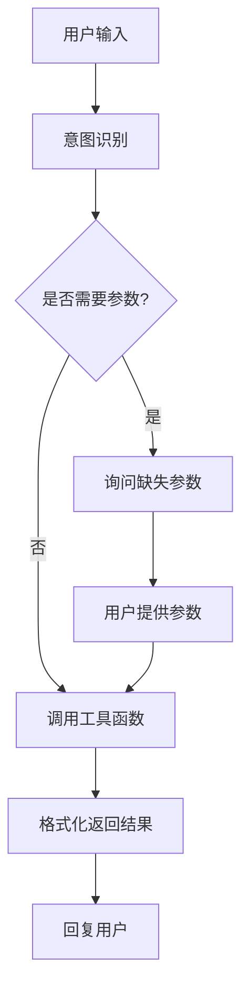

# Week07: 多轮对话与工具调用

## 项目概述

本项目实现了一个智能客服系统，展示多轮对话与工具调用的核心功能：

- **智能意图识别**：自动识别用户的查询订单或退款申请意图
- **多轮参数收集**：当缺少必要信息时，主动询问用户
- **工具自动调用**：根据用户需求自动调用相应的后端工具
- **状态管理**：维护对话上下文，支持复杂交互流程

## 核心流程



## 项目结构

```
week07/
├── __init__.py              # 模块初始化
├── config.py               # 配置文件（API密钥、模拟数据）
├── tools.py                # 工具函数（订单查询、退款申请）
├── simple_dialogue.py      # 简化版对话管理器
├── dialogue_graph.py       # LangGraph版对话管理器（高级版）
├── demo.py                 # 主演示程序
├── main.py                 # 完整主程序（需要OpenAI API）
└── README.md               # 项目文档
```

## 功能特性

### 1. 订单查询流程
- 用户说："查订单" → 系统追问："请提供订单号"
- 用户提供："ORD001" → 系统调用 `query_order()` 工具
- 返回详细的订单状态和物流信息

### 2. 退款申请流程  
- 用户说："申请退款" → 系统追问："请提供订单号"
- 用户提供："ORD002" → 系统调用 `apply_refund()` 工具
- 返回退款申请结果和退款单号

### 3. 智能参数提取
- 支持一次性输入：「查订单 ORD001」
- 自动提取订单号，直接执行查询

## 运行方式

### 方法1：使用简化版演示（推荐）
```bash
cd week07
python demo.py
```

### 方法2：使用完整版（需要OpenAI API）
```bash
cd week07
python main.py
```

### 方法3：使用uv运行（从项目根目录）
```bash
uv run python week07/demo.py
```

## 测试数据

系统内置了以下测试订单：

| 订单号 | 状态 | 商品 | 说明 |
|--------|------|------|------|
| ORD001 | 已发货 | iPhone 15 Pro, AirPods Pro | 可查询物流 |
| ORD002 | 配送中 | MacBook Air | 可申请退款 |
| ORD003 | 已完成 | iPad Pro, Apple Pencil | 已完成订单 |

## 使用示例

### 场景1：订单查询
```
用户: 我要查订单
助手: 请提供您要查询的订单号（格式如：ORD001）
用户: ORD001
助手: ✅ 订单查询成功！
      📦 订单信息
      • 订单号: ORD001
      • 订单状态: 已发货
      • 商品: iPhone 15 Pro, AirPods Pro
      • 总金额: ¥9998.0
      🚚 物流信息
      • 快递公司: 顺丰快递
      • 快递单号: SF1234567890
      • 当前位置: 上海分拣中心
      • 预计送达: 2024-01-15
```

### 场景2：退款申请
```
用户: 申请退款
助手: 请提供要申请退款的订单号（格式如：ORD001）
用户: ORD002
助手: ✅ 退款申请提交成功！退款单号: REF002001
      退款金额: ¥7999.0
      预计3-5个工作日到账
```

### 场景3：一次性查询
```
用户: 查订单 ORD003
助手: ✅ 订单查询成功！
      📦 订单信息
      • 订单号: ORD003
      • 订单状态: 已完成
      • 商品: iPad Pro, Apple Pencil
      ...
```

## 技术实现

### 简化版实现 (`simple_dialogue.py`)
- 使用状态机模式管理对话流程
- 基于规则的意图识别
- 无需外部API依赖，适合演示和学习

### 高级版实现 (`dialogue_graph.py`)
- 基于LangGraph构建状态图
- 集成OpenAI GPT模型
- 支持更复杂的对话理解和生成

## 扩展功能

系统设计支持轻松扩展：

1. **新增工具函数**：在 `tools.py` 中添加新的业务功能
2. **新增意图类型**：在意图识别中添加新的关键词匹配
3. **增强参数收集**：支持收集更多类型的参数
4. **改进对话理解**：使用更高级的NLP模型

## 项目亮点

- ✅ **零依赖演示**：简化版无需API密钥即可运行
- ✅ **完整工作流**：展示从意图识别到工具调用的完整流程  
- ✅ **实用场景**：基于真实客服场景设计
- ✅ **易于扩展**：模块化设计，便于添加新功能
- ✅ **详细文档**：提供完整的使用说明和技术文档